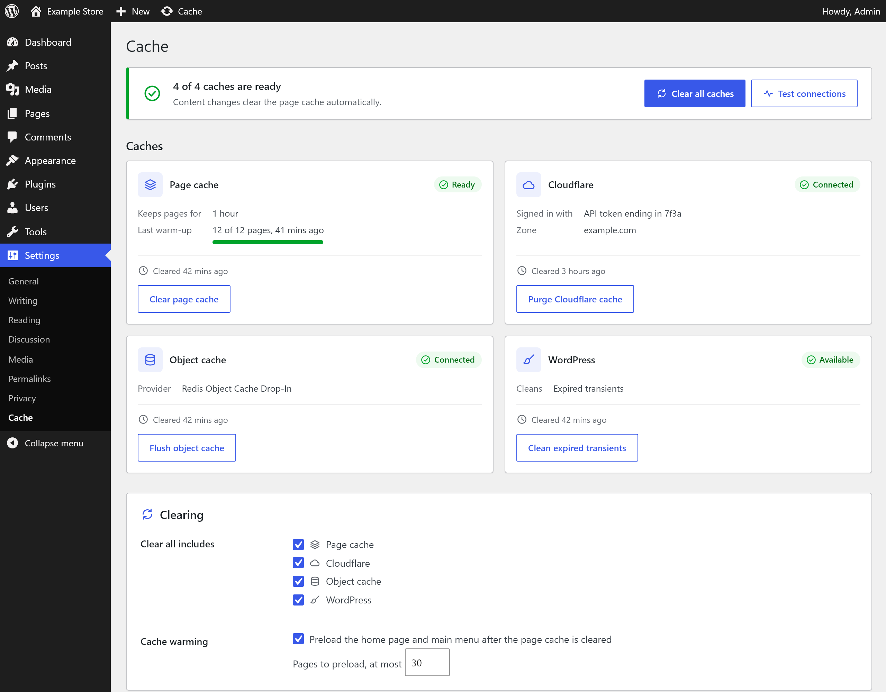
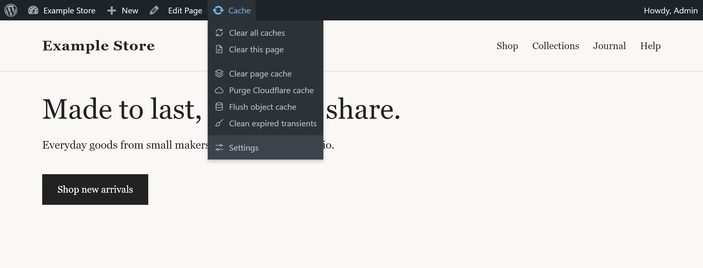

# Cache Manager for CloudPanel

A WordPress plugin for sites hosted on [CloudPanel](https://www.cloudpanel.io/). It gives your site a fast Varnish page cache that clears itself when you change content, and one place to clear every cache the site uses.



## What it clears

| Cache | What the plugin does | What it needs |
|---|---|---|
| **Page cache** | Serves pages to visitors from Varnish (kept for an hour by default) and clears them as soon as you edit content. | CloudPanel Companion |
| **Cloudflare** | Purges your Cloudflare zone, or a single page, when you ask. | An API token, or the Cloudflare plugin signed in |
| **Object cache** | Flushes Redis, Memcached or any other persistent object cache. | An object cache drop-in |
| **WordPress** | Removes expired transients and, if you use Elementor, regenerates its CSS files. | Nothing |

Only the page cache needs the CloudPanel Companion. Without it, the plugin still clears Cloudflare, the object cache and WordPress's own caches, and the page cache simply shows as **Off**.

## Requirements

- WordPress 6.2 or later and PHP 8.1 or later, on a single site (multisite is not supported).
- For the page cache: a CloudPanel server with [CloudPanel Companion](https://github.com/bomsn/cloudpanel-companion), which sets up Varnish and the small local service the plugin talks to.

## Installation

**With the page cache.** On the server, download the plugin next to the Companion and run the Companion's installer:

```shell
git clone https://github.com/bomsn/cloudpanel-companion.git
git clone https://github.com/bomsn/cache-manager-for-cloudpanel.git
cd cloudpanel-companion
sudo bash install.sh
```

Answer **yes** when it asks about the page cache and confirm the plugin folder (it suggests the copy next to the Companion). The installer copies the plugin into your site, adds its settings to `wp-config.php`, starts Varnish and activates the plugin.

**Without the page cache.** Add the plugin to your site and activate it:

```shell
cd wp-content/plugins
git clone https://github.com/bomsn/cache-manager-for-cloudpanel.git
wp plugin activate cache-manager-for-cloudpanel
```

You can also activate it under **Plugins** in the dashboard.

## Using it

### Settings > Cache

The top of the screen tells you whether every cache is ready or which one needs attention, with two buttons:

- **Clear all caches** clears every cache you chose in the settings (all of them by default).
- **Test connections** checks that the page cache service accepts your site's purge key and can reach Varnish, and that Cloudflare accepts the sign-in and can find your zone. It never clears anything.

Below that, each cache has a card with its status, the details that matter (how long pages are kept, the last warm-up, the Cloudflare zone, the object cache provider), when it was last cleared and its own button.

At the bottom you can choose:

- **Clear all includes**: which caches **Clear all caches** clears.
- **Cache warming**: after the page cache is cleared, the home page and the pages in your main menu are loaded again in the background, so your first visitors get cached pages. It is on by default, for up to 30 pages.
- **Cloudflare**: your API token and, if needed, the Zone ID (see below).

### The Cache menu



Administrators get a **Cache** menu in the admin bar, both on the site and in the dashboard:

- **Clear all caches**.
- **Clear this page** (on the site only) clears the page you are looking at from the page cache and Cloudflare.
- One item per cache the site has: **Clear page cache**, **Purge Cloudflare cache**, **Flush object cache**, **Clean expired transients** and, with Elementor, **Regenerate Elementor CSS**.
- **Settings** opens Settings > Cache.

An amber dot next to **Cache** means the page cache needs attention: its settings in `wp-config.php` are invalid, its service is down (pages are served uncached until it recovers), or a clear failed. The reason is shown at the top of the menu.

After every action, a short notice lists each cache and what happened to it: cleared, skipped (with the reason) or failed (with the reason).

### After plugin, theme and WordPress updates

When plugins or themes are installed, updated, activated, deactivated or deleted, the theme is switched or WordPress is updated (from the dashboard, WP-CLI or automatic updates), administrators see a notice in the dashboard saying what changed. The page cache is usually cleared for you, and the notice says when it was, but Cloudflare and the object cache keep what they had. If anything looks out of date, click **Clear all caches** in the notice. **Dismiss** hides it until the next change. It also goes away when **Clear all caches** succeeds from anywhere (the notice, the Cache menu, Settings > Cache or `wp cloudpanel-cache purge --layer=all`), or a week after the last change.

## Connecting Cloudflare

Cloudflare is optional, and there are two ways to connect it.

**With your own API token.** In Cloudflare, go to **My Profile > API Tokens > Create Token** and create a custom token for your site's zone with these permissions:

- **Zone > Cache Purge > Purge**
- **Zone > Zone > Read** (lets the plugin find the zone; without it, enter the Zone ID in the settings)

Paste the token into **Settings > Cache**, save, and click **Test connections**. The token is stored apart from the other settings, is never shown again (only its last four characters) and is removed when you delete the plugin. You can put it in `wp-config.php` instead:

```php
define( 'CACHE_MANAGER_FOR_CLOUDPANEL_CLOUDFLARE_TOKEN', 'your-token' );
```

**With the Cloudflare plugin.** If the official Cloudflare plugin is active and signed in, and you haven't saved a token, its sign-in is used. There is nothing else to set up.

Good to know:

- Cloudflare is only purged when you ask. If you use the Cloudflare plugin, it keeps purging the pages you change, and with the page cache on, Cloudflare and browsers keep a page for at most 5 minutes.
- **Purge Cloudflare cache** clears the whole zone, which includes any other sites on the same domain.

## Command line

```shell
wp cloudpanel-cache purge                                # page cache, whole site
wp cloudpanel-cache purge --layer=all                    # everything chosen for Clear all caches
wp cloudpanel-cache purge --layer=cloudflare             # page_cache, cloudflare, object_cache or wordpress
wp cloudpanel-cache purge https://example.com/shop/      # one page, in the page cache and Cloudflare
wp cloudpanel-cache status                               # the state of each cache
```

`purge` exits with an error when nothing was cleared or a cache failed, so deploy scripts can rely on it.

## Updating

Each release is published as a single commit, so update with a fetch and reset rather than `git pull`.

**With the page cache**, update the folder you cloned, then run the Companion's upgrade from the Companion folder, with your site's address, its CloudPanel site user and its PHP version:

```shell
cd cache-manager-for-cloudpanel && git fetch origin && git reset --hard origin/master
cd ../cloudpanel-companion
sudo python3 install-cache.py --host shop.example.com --user shop --php 8.3 --plugin-source ../cache-manager-for-cloudpanel --upgrade
```

It shows a short maintenance page, swaps the plugin, checks the site and puts the old version back automatically if anything fails. Don't copy plugin files over the live folder by hand.

**Without the page cache**, update the plugin folder in your site directly:

```shell
cd wp-content/plugins/cache-manager-for-cloudpanel && git fetch origin && git reset --hard origin/master
```

## Deactivating and deleting

- **Deactivating:** while the page cache is on, WordPress only lets you deactivate the plugin once the page cache has been cleared, so visitors never see stale pages.
- **Deleting** the plugin removes its settings, the saved Cloudflare token, its clear and warm-up history, any pending change notice, its invalidation queue table and its scheduled tasks. The page cache settings in `wp-config.php` stay; to retire the page cache completely, follow "Disabling or retiring an installation" in the Companion's [how-it-works guide](https://github.com/bomsn/cloudpanel-companion/blob/master/docs/how-it-works.md).

## What the page cache stores

**Cached:** normal pages for visitors who aren't logged in, including visitors who only have analytics cookies (Google Analytics, Meta, Hotjar, ContentSquare, Microsoft Clarity, WooCommerce order attribution, Cloudflare bot checks) and links with campaign tags (`utm_*`, `gclid`, `fbclid`, `msclkid`, Mailchimp).

**Never cached:** logged-in users, carts and checkout, account pages, visitors with any other cookie, other query strings, the REST API, `wp-admin`, and any page that sets a cookie or says `private` or `no-store`.

Pages are cleared automatically when you change a post, page, product, price, stock level, category, menu, widget, theme or plugin. Visitors reading the site never clear it, even when a plugin records something on each page view (a view counter, for example). If the cache service stops, the site keeps working and runs uncached until it is back.

## For developers

- **Check a page:** the `X-Cache-Manager-For-CloudPanel` response header is `HIT` (served from the cache), `MISS` (just built and stored) or `BYPASS` (deliberately not cached).
- **Clear after your own changes:** if your theme or another plugin changes something this plugin can't see (custom term meta, an options page), clear the page cache for the whole site after saving. It is sent when the request ends, with automatic retries, and does nothing while the page cache is off.

  ```php
  do_action( 'cache_manager_for_cloudpanel_purge' );
  ```

- **Warm more pages:** add pages on your site to the warm-up list. Addresses with a query string are skipped, and the **Pages to preload** limit still applies.

  ```php
  add_filter( 'cache_manager_for_cloudpanel_warm_urls', function ( $urls ) {
      $urls[] = home_url( '/shop/' );
      return $urls;
  } );
  ```

- **Keep pages longer or shorter:** set `CACHE_MANAGER_FOR_CLOUDPANEL_ORIGIN_TTL` in `wp-config.php` to a number of seconds between 300 and 86400 (the default is 3600). The 5-minute limit for Cloudflare and browsers stays the same.
- **Tests:** `python3 tests/php_checks.py` lints every PHP file and runs the unit checks. It needs only a PHP 8.1+ command line. The Varnish rules in `server/cache-policy.vcl` are tested against real Varnish and the Companion's cache service with `python3 tests/varnish_policy.py /path/to/cloudpanel-companion` (Linux, with `varnishd` installed).

## License

GPL-2.0-or-later. See [LICENSE.txt](LICENSE.txt).
